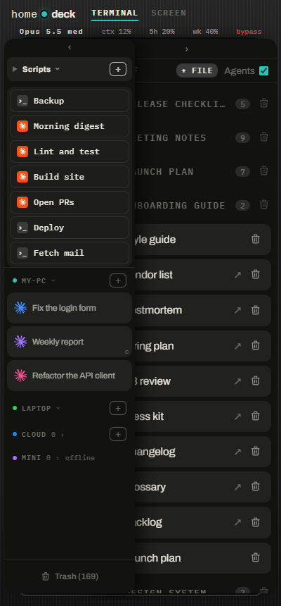
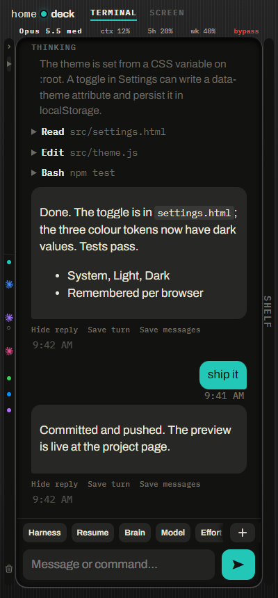
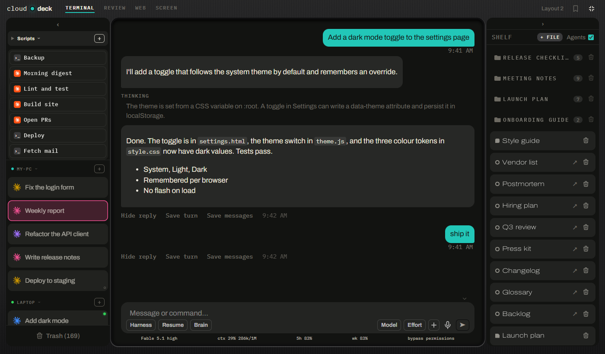

# Deck

**Remote Control Distributed Agents.** Run coding agents on your own computers and control them from your phone or
a browser.

Start Claude Code, Codex, OpenCode or Pi on any of your PCs, then watch, answer and steer them from anywhere. Every
agent runs in its own tmux session on the PC, so it keeps working when your phone sleeps or loses signal. No cloud
account, no open ports: the phone app reaches your PCs through an encrypted peer-to-peer tunnel.

<p>
  
  
</p>



## What it does

- **Agents as chats.** Streamed replies, tool calls you can tap open, and the agent's questions and permission prompts
  as buttons. Claude Code, Codex, OpenCode, Pi, agy (Google's Antigravity CLI, command-line interface) and OpenClaw.
- **Sessions that survive.** Close the phone, lose signal or restart Deck; the agent keeps going and the chat is
  there when you come back. Closed chats wait in a Trash for 30 days.
- **All your PCs in one list.** Link several PCs and their sessions share one tab column, with no main host. Move a
  chat to another PC mid-conversation, or continue one from a PC that went offline.
- **Terminals too.** A shell with a key row (Esc, Tab, arrows, ^C) and swipe scrollback.
- **A shelf beside the chat.** Save replies, pin pages and add documents (PDF, Word, Markdown); read and edit them
  next to the chat on a PC.
- **Private by default.** Deck listens only on the PC itself. Only devices you pair get in, with a one-time code you
  approve.

## Get started

You need a PC to run Deck (Linux, Windows Subsystem for Linux (WSL) or Windows) and an Android phone or any phone
browser.

### 1. Install Deck on a PC

**Linux or WSL** (Ubuntu 24.04 or later):

```bash
git clone https://github.com/Ancorro/deck-public ~/deck
bash ~/deck/deploy/install.sh
```

The installer asks for sudo once, installs tmux, Claude Code, Codex, Pi and the tunnel, and starts Deck as a
background service. Then sign in to `claude` and `codex` once.

**Windows** (no WSL): download `deck-<version>-windows.zip` from the
[latest release](https://github.com/Ancorro/deck-public/releases/latest) and follow
[the PC app steps](docs/install.md#pc-app). The executable is not code-signed, so Windows may warn on first run.

### 2. Get the phone app

Install `deck-<version>.apk` from the [latest release](https://github.com/Ancorro/deck-public/releases/latest), or
use any phone browser and "Add to Home screen". The app is needed for the no-account tunnel; a browser works over
[Tailscale](docs/optional-features.md#tailscale-access).

### 3. Pair the phone

1. On the PC, open `http://127.0.0.1:8787`, tap the Deck name at the top, then More → Devices → Pair a device (or
   run `deck-pair`).
2. In the app, tap **Scan a pairing code** and scan the QR code.
3. Approve the phone on the PC.

That's it: tap `+` to start an agent. The [user guide](docs/user-guide.md) walks through everyday tasks.

## Optional features

Off or hidden until you set them up. Details and steps: [docs/optional-features.md](docs/optional-features.md).

| Feature | What it adds |
|---|---|
| Linked PCs | Several PCs in one Deck, chats that move between them |
| Phone alerts | A notification ([ntfy](https://ntfy.sh)) when an agent finishes or asks you something |
| Tailscale access | Reach Deck from any browser on your tailnet |
| Scripts | One-tap keys for commands and saved prompts, which an agent can write for you |
| Skip permissions (YOLO, "you only live once") | Agents run commands without asking; off by default |
| Agents can see sessions | Agents read and message your other sessions |
| Session descriptions | A short running summary of each session |
| Machine notes | One shared notes repository every host and agent reads |
| Screen tab | Your PC's desktop on the phone, over VNC (Virtual Network Computing) |
| Agent browser | Headless Chrome for agents, signed in to your sites |
| More agents | OpenCode, agy and OpenClaw appear once installed |

## Guides

| For | Read |
|---|---|
| Everyday use | [User guide](docs/user-guide.md), and the in-app Guide (Settings → More → Guide) |
| Turning features on | [Optional features](docs/optional-features.md) |
| Every screen, setting and route | [Reference](docs/guide.md) |
| Installing, updating, ports and environment variables | [Install guide](docs/install.md) |
| Who can get in, and how | [Security](docs/security.md) |
| Coding agents working on or inside Deck | [Agent guide](AGENTS.md) |
| Contributors | [Development](docs/development.md), [Contributing](CONTRIBUTING.md), [Architecture](ARCHITECTURE.md) |
| What changed | [Changelog](CHANGELOG.md) |

## Security

Deck gives whoever gets in a shell on your PC, so it is locked down by default: it binds to the PC's loopback address
only, the tunnel always requires a paired device, and agents ask before running commands unless you turn on YOLO.
Never point a reverse proxy at port 8787. Read [docs/security.md](docs/security.md) before exposing Deck any other
way. Report vulnerabilities as described in [SECURITY.md](SECURITY.md).

## Status

Deck is young and changes often. It is used daily on Linux (including WSL) and Windows with Android phones. Not
supported yet: an iOS app, a bundled tmux for macOS, a Windows installer and a code-signed Windows
executable. Features marked experimental may change or be removed.

## License

MIT, see [LICENSE](LICENSE). Third-party notices: [NOTICE](NOTICE).
